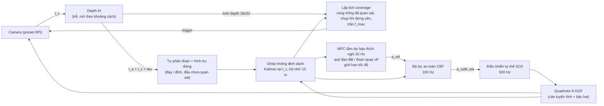

# DART-UAV

**DART — Delay-Aware, Risk-Triggered perception–control co-design**: đồng thiết kế nhận thức – điều khiển cho
quadrotor chi phí thấp tránh vật cản lớn bằng một camera và mạng ước lượng depth đơn mắt có độ trễ, với mục tiêu giảm
chi phí tính toán. Toàn bộ mô phỏng (MATLAB/Simulink) chạy trên **GitHub Actions**, không cần cài đặt cục bộ.

| | |
|---|---|
| **Kết quả** | [`docs/results/results.md`](docs/results/results.md): phiên bản chốt (thuật toán commit `2a536b1`), 36 000 lượt bay; tóm tắt ở [Mục 5](#5-kết-quả) |
| Tài liệu và kết quả các phiên bản trước | [`docs/archive/`](docs/archive/README.md): tài liệu phương pháp LaTeX (bản 3), kết quả các vòng 2–7; không áp dụng cho phiên bản chốt |
| Mô hình Simulink | sinh từ mã bởi [`simulink/dart_build_model.m`](simulink/dart_build_model.m) → `dart_closed_loop.slx` |
| Chạy trên cloud | tab **Actions**: `CI`, `Experiments`, `Sweep`, `Debug case`, `Docs` |

---

## 1. Phạm vi

* **UAV chi phí thấp, tài nguyên tính toán hạn chế**, bay ở độ cao thấp. Đối tượng cần tránh là **vật cản lớn, tĩnh**:
  cây có tán thấp, bụi cây, nhà / ki-ốt, xe / container, tảng đá. Cột mảnh nằm ngoài phạm vi.
* Tốc độ thích nghi theo mật độ vật cản; giới hạn vật lý lấy từ mô hình động học quadrotor.
* Suy luận depth là khâu tốn tính toán nhất; mục tiêu là **giảm số lần suy luận trong khi giữ an toàn**.
* Phương pháp giả thiết mọi vật cản là tĩnh. Vật di chuyển chỉ xuất hiện trong một phần thế giới kiểm thử khó và không
  được thông báo cho thuật toán.
* Không giới hạn thời gian bay. Một lượt kết thúc khi tới đích, va chạm, hoặc kẹt (tiến dưới 1 m dọc quỹ đạo đặt trong
  60 s).

## 2. Phương pháp (phiên bản chốt, commit `2a536b1`)

1. **Mô hình camera và mạng depth** ([`dart_camera_preset.m`](src/config/dart_camera_preset.m),
   [`dart_depth_network.m`](src/perception/dart_depth_network.m)). Bốn preset camera Raspberry Pi; mặc định Camera
   Module 3 Wide (góc ngang 102°), mạng depth ở 320×180, thời gian suy luận trung bình 80 ms. Ảnh được render siêu lấy
   mẫu và lấy trung bình theo diện tích pixel; mô hình sai số gồm mờ theo khoảng cách, mờ chuyển động, sai số tỉ lệ và
   dịch chuyển theo từng khung, trường sai số tương quan, nhiễu pixel, điểm ngoại lai và sương mù (tuỳ chọn). Tầm phát
   hiện đo được (≥ 90 % khung, vật bán kính 1 m) là 30 m; tầm tin cậy dùng trong điều khiển R_eff = 26 m.
2. **Biểu diễn vật cản bằng hình trụ đứng** ([`dart_extract_obstacles.m`](src/perception/dart_extract_obstacles.m),
   [`dart_cyl_dist.m`](src/util/dart_cyl_dist.m)). UAV chỉ nhận ảnh depth đầu ra của mạng, **tự phân đoạn** vật cản (vùng
   depth liên thông, lọc pixel lẫn và mép), rồi phủ mỗi vùng bằng một hoặc nhiều hình trụ đứng:
   * trục và bán kính ngang được ước lượng từ cung quan sát trong mặt phẳng ngang, bán kính phủ 90 % số điểm của vùng
     (`cam.cover_q`); phương thẳng đứng lấy từ tư thế tại thời điểm chụp (trong mô phỏng: tư thế thật; trên phần cứng:
     hướng trọng lực từ IMU); vùng có nửa bề rộng lớn hơn 2 m + 0.1 × khoảng cách (`cam.r_chunk`) được chia thành nhiều
     hình trụ;
   * đáy và đỉnh là điểm thấp nhất / cao nhất quan sát được. Đầu nào chạm mép ảnh hoặc bị một vật gần hơn che được coi là
     **chưa quan sát**: hình trụ kéo tới mặt đất (hoặc lên cao) cho tới khi đầu đó được quan sát.
   Nhờ đó vật thấp (xe) và tán cây cao không chặn độ cao bay như khi dùng hình cầu bao.
3. **Bộ nhớ vật cản** ([`dart_tracks_process_msg.m`](src/estimation/dart_tracks_process_msg.m),
   [`dart_tracks_prune.m`](src/estimation/dart_tracks_prune.m)). Phát hiện được ghép với track không cần định danh
   (gating χ², gán tham lam một – một); mỗi track là một **mốc tĩnh** cập nhật Kalman tại **đúng thời điểm chụp** (bù
   trễ). Bán kính được làm mượt theo hệ số `trk.rho_alpha` = 0.3 (lấy giá trị lớn hơn nếu phát hiện bị cắt ở mép ảnh);
   đáy / đỉnh được làm mượt cùng hệ số, và một đầu chưa quan sát được thay bằng giá trị đo ở lần đầu quan sát được.
   Phát hiện không ghép được nhưng nằm trong một track có sẵn được bỏ qua; còn lại tạo track mới. Track bị loại khi:
   (a) dự đoán nằm trong ảnh, không bị che, nhưng không ghép được trong `trk.n_miss` = 3 khung liên tiếp (track mới có
   dưới 2 lần cập nhật: ngay lần đầu); (b) tâm ngoài trường nhìn và khoảng cách từ UAV tới bề mặt hình trụ lớn hơn
   `trk.forget_dist` = 10 m.
4. **Khoảng cách tới hình trụ** dùng chung cho mọi khối: lớp an toàn CBF (100 Hz), các đại lượng rủi ro, bộ lập lịch và
   giới hạn tốc độ dùng "hình cầu tương đương cục bộ" tại vị trí UAV, cho đúng khoảng cách và pháp tuyến của hình trụ
   ([`dart_obstacles_local.m`](src/estimation/dart_obstacles_local.m)); MPC tuyến tính hoá hình trụ tại từng điểm dự đoán;
   đường vòng và phát hiện đoạn bị chặn tính trực tiếp trên hình trụ (vật thấp hơn độ cao bay có thể được bay qua).
5. **Lập lịch nhận thức "coverage"** (phương án `E_COV`, phương pháp đề xuất,
   [`dart_scheduler.m`](src/scheduling/dart_scheduler.m)). Chụp khi đoạn quỹ đạo dự kiến phía trước, tới quãng cần để
   dừng sau kết quả kế tiếp, **chưa nằm trong vùng trống đã quan sát** (vùng trống theo tia: lưới depth thô 18×32 gửi kèm
   mỗi kết quả; điểm cách bề mặt đo được dưới d_s hoặc phía sau bề mặt không tính là đã quan sát). Quãng cần để dừng là
   v·τ + v²/(2a_b) + d_s (τ: độ trễ ước lượng). Các sự kiện chụp bổ sung: độ bất định của một vật có thể quan sát lại lớn hơn đáng
   kể so với sai số của một phép đo mới (lọc theo độ lợi thông tin), chế độ khẩn cấp (vật trên hướng va chạm có biên dừng
   âm), và **chụp liên tục khi UAV gần như đứng yên** (|v| < `sched.v_stall` = 1 m/s) để đo lại các vật xung quanh ở
   khoảng cách gần. Mỗi thời điểm chỉ có một khung đang được xử lý.
6. **Tần số quét tối đa `f_max` là ràng buộc cứng** cho mọi bộ lập lịch và mọi sự kiện (kể cả khẩn cấp). Mặc định 3 Hz;
   lưới thử nghiệm quét 0.5–5 Hz. Hai bộ lập lịch đối chứng: `FR_SAFE` (chụp đều đúng `f_max`) và `E_DART` (thích nghi
   theo rủi ro, cũng bị giới hạn bởi `f_max`).
7. **Giới hạn tốc độ** ([`dart_derive_limits.m`](src/config/dart_derive_limits.m)):
   * vật lý: tỉ số lực đẩy / trọng lượng 2.4, dự trữ lực đẩy 40 % → nghiêng tối đa 46°, gia tốc phanh 6.2 m/s², tốc độ
     giới hạn bởi lực cản 16.7 m/s, v_max = 15 m/s; với camera có góc dọc hẹp, v_max được giới hạn thêm để quỹ đạo không
     rời khỏi ảnh khi UAV chúi mũi;
   * theo tầm nhìn: v·T_r + v²/(2a_b) + d_s ≤ R_eff, T_r = max(1/f_max, độ trễ) + độ trễ, d_s = 0.5 m
     ([`dart_perception_speed.m`](src/scheduling/dart_perception_speed.m));
   * theo mật độ vật cản ([`dart_clutter_speed.m`](src/control/dart_clutter_speed.m), bật mặc định): tốc độ tiếp cận
     mỗi vật trong hành lang bay phải đủ để phanh.
8. **MPC tầm dự báo thích nghi + quỹ đạo đặt / đoạn quay về** ([`dart_mpc.m`](src/control/dart_mpc.m)): QP 20 Hz,
   tầm dự báo 1–3 s, hàm mục tiêu gồm sai lệch vị trí, vận tốc so với tham chiếu, gia tốc và độ giật; khoảng cách tới vật
   cản là ràng buộc (bán kính + d_s + β·σ, có biến bù) cùng ràng buộc CBF rời rạc và điều kiện dừng ở cuối tầm dự báo. Khi
   phía trước bị chặn, tham chiếu là đường ngắn nhất không va chạm tới điểm sớm nhất sau đoạn bị chặn, trong thời gian đó
   không phạt sai lệch so với quỹ đạo đặt.
9. **Siêu tham số κ ∈ [0, 1]** điều chỉnh đánh đổi an toàn ↔ thời gian (mặc định 0.5).



Quy ước trong chú thích mã nguồn: "Eq. n" là số phương trình của bản đề xuất gốc; "method §n" là mục của tài liệu
phương pháp bản 3, nay ở [`docs/archive/method/`](docs/archive/method/). Tài liệu đó được viết trước các thay đổi ở các
mục 1–7 phía trên; mô tả của phiên bản chốt là mục này cùng chú thích trong mã.

## 3. Chạy trên cloud (GitHub Actions)

| Workflow | Kích hoạt | Nội dung | Kết quả |
|---|---|---|---|
| **CI** | mỗi lần push | (a) *Octave*: toàn bộ unit test + 1 nhiệm vụ demo, không cần license; (b) *MATLAB + Simulink*: unit test, sinh model `.slx`, chạy vòng kín trong Simulink | Artifact `octave-results`, `matlab-simulink-results`, bảng ở trang tóm tắt |
| **Sweep** | thủ công | Quét một tham số (`speed`, `rate`, `speedrate`, `camera`, `camspeed`, `camspeedrate`, `latency`, `noise`, `shift`, `kappa`, `rmin`, `fog`) qua danh sách giá trị; mỗi (kịch bản, giá trị) là một job song song | Artifact `sweep-…`; log có dòng kết quả, `DENS`, `FAILINFO`, `WORLD` |
| **Experiments** | thủ công | Monte-Carlo: phương án × kịch bản × seed, engine `matlab` / `simulink` / `octave` | Artifact `ablation-…` |
| **Debug case** | thủ công | Chạy lại một trường hợp và in diễn biến những giây cuối; `cases`: xuất trạng thái để vẽ hình; `collisions`: chạy lại các va chạm, so sánh khoảng cách ước lượng theo bộ nhớ với khoảng cách thật; thêm `trace`: ghi mọi thay đổi của bộ nhớ vật cản | Log + artifact |
| **Docs** | push thay đổi `docs/**` | Biên dịch tài liệu phương pháp (bản lưu trữ) bằng XeLaTeX | Artifact `DART-method-pdf` |

### 3.1. License MATLAB trên GitHub Actions

GitHub Actions cài MATLAB/Simulink qua [`matlab-actions/setup-matlab`](https://github.com/matlab-actions/setup-matlab).

* **Repo public** (hiện tại): MathWorks cấp license tự động.
* **Repo private**: cần **batch licensing token**:
  1. Đăng ký token tại [MATLAB Batch Licensing Pilot](https://www.mathworks.com/support/batch-tokens.html) (tài khoản MathWorks có license MATLAB + Simulink).
  2. *Settings → Secrets and variables → Actions → New repository secret*, tên **`MLM_LICENSE_TOKEN`**.
  3. Push bất kỳ; job *MATLAB + Simulink* sẽ chạy.

Khi không có license, job MATLAB của **CI** được bỏ qua kèm cảnh báo và job Octave vẫn kiểm tra toàn bộ thuật toán. Các
workflow Experiments / Sweep / Debug case cần license.

### 3.2. Chạy lại lưới thử nghiệm

Mọi phần dùng cùng thế giới, cùng tốc độ yêu cầu 6 / 10 / 15 m/s và cùng lưới trần tần số 0.5–5 Hz. *Actions → Sweep →
Run workflow*, `engine = matlab`; mỗi giá trị của cột `seeds` là một lần chạy (song song):

| Phần | `param` | `values` | `scenarios` | `variants` | `seeds` |
|---|---|---|---|---|---|
| Quét trần tần số | `speedrate` | 30 giá trị: 100 × tốc độ + 10 × tần số, tốc độ 6 / 10 / 15, tần số 0.5…5 Hz (`[605, 610, …, 650, 1005, …, 1550]`) | `["SN"]`, `["SH"]`, `["SE"]` | `E_COV,FR_SAFE,E_DART` | SN `1:20`, `21:40`, `41:60`; SH `1:10`, `11:20`, `21:30`; SE `1:30` |
| Không giới hạn tốc độ theo mật độ | `speedrate` | 30 giá trị như trên | từng kịch bản | `COV_NOCLUT` | SN `1:60`; SH `1:30`; SE `1:30` |
| Camera | `camspeedrate` | 90 giá trị: 10000 × preset (1, 2, 4) + 100 × tốc độ + 10 × tần số | từng kịch bản | `E_COV,FR_SAFE` | SN `1:30`, `31:60`; SH `1:15`, `16:30`; SE `1:30` |

Ví dụ: `speedrate` 1025 = 10 m/s, trần 2.5 Hz; `camspeedrate` 41025 = preset 4 (Module 3 Wide 640×360), 10 m/s, trần
2.5 Hz; camera mặc định (preset 3) lấy từ phần quét tần số. Mỗi lượt in một dòng kết quả (kèm `gap`, khoảng cách nhỏ
nhất giữa hai lần chụp) và một dòng `DENS` (thời gian, quãng bay, số khung theo số vật trong bán kính 15 m). Lập bảng:
`python3 docs/results/parse_results.py '<log>'` (một nhóm log) hoặc `python3 docs/results/final_tables.py` (toàn bộ
lưới, các bảng của `results.md`).

## 4. Kịch bản và phương án

| Kịch bản | Mô tả |
|---|---|
| **SN** (bay thường) | tuyến 300 m (1–3 đoạn, độ cao 2–3.5 m) chia thành các vùng 40–80 m: 35 % trống, 40 % thưa (1–3 vật, một nửa trong phạm vi 2 m quanh tuyến), 25 % dày (6–12 vật). Vật cản lớn: cây tán thấp, bụi cây, nhà, xe / container, đá; khe hở ≥ 3.5 m ([`dart_scenario_normal.m`](src/config/dart_scenario_normal.m)) |
| **SH** (khó) | như SN nhưng mọi vùng đều dày; sương mù (tầm nhìn 200 m) ở seed lẻ; 2 phương tiện cắt ngang tuyến (2–4 m/s) ở seed chia hết cho 3 |
| **SE** (đời thường) | tuyến thẳng 200 m; loại cảnh theo seed (chu kỳ 6): bãi trống, một cây trên tuyến, đại lộ hai hàng cây, xe đỗ ven đường và một xe tải trên tuyến, dãy nhà ven tuyến, khe phố giữa hai dãy nhà ([`dart_scenario_easy.m`](src/config/dart_scenario_easy.m)) |
| S1–S3, SR | kịch bản của các phiên bản trước (còn trong mã, kết quả ở `docs/archive/`) |

| Phương án | Lập lịch nhận thức | Ghi chú |
|---|---|---|
| **E_COV** | coverage, trần `f_max` | phương pháp đề xuất |
| FR_SAFE | chụp đều đúng `f_max` | cùng các lớp an toàn |
| E_DART | thích nghi theo rủi ro, trần `f_max` | chu kỳ quét tính từ khoảng thời gian còn an toàn khi chưa có ảnh mới, cùng các sự kiện khoảng cách, độ bất định, khẩn cấp |
| COV_NOCLUT | coverage, trần `f_max` | E_COV không dùng giới hạn tốc độ theo mật độ (đánh giá vai trò của khối này) |

**Giới hạn tốc độ theo mật độ** (`dart_clutter_speed.m`): với mỗi vật trong hành lang bay phía trước (khoảng cách
lướt qua < d_s + β_d·σ + 2 m), tốc độ mong muốn được giới hạn để tốc độ tiếp cận luôn đủ phanh,
v cos θ ≤ 0.9 √(2 a_b (d − d_s)) (d: khoảng cách tới bề mặt đã trừ phần bất định, θ: góc giữa hướng bay và hướng tới
vật), với cận dưới 1.5 m/s. Khi tắt khối này (COV_NOCLUT), UAV vẫn có giới hạn vật lý, giới hạn theo tầm nhìn, lớp CBF
100 Hz (cùng điều kiện phanh, tác động trực tiếp lên lệnh gia tốc) và chế độ khẩn cấp.

Các phương án của phiên bản trước (`A_FR_FN` … `G_FR_LOW`, `Z_ZHUYI`, `O_ORACLE`, `R_*`, `K<k>`, `MEM<d>`,
`FR_SAFE_<f>`, `FN_SAFE_n`, `COVB<f>`, `E_NOCAP`, `FRNC<f>`, `COV_EV`, `COV_NOCAP`) vẫn có trong
[`dart_apply_variant.m`](src/config/dart_apply_variant.m); phương án có tần số cố định đặt `f_max` bằng tần số đó.

## 5. Kết quả

Chi tiết: [`docs/results/results.md`](docs/results/results.md). 36 000 lượt (thuật toán commit `2a536b1`), cùng lưới
trần tần số 0.5–5 Hz, cùng thế giới và tốc độ yêu cầu 6 / 10 / 15 m/s; camera mặc định Module 3 Wide.

| | SN bay thường | SH khó | SE đời thường |
|---|---|---|---|
| E_COV, trần 3 Hz: va chạm tĩnh / kẹt / suy luận mỗi nhiệm vụ (trung vị) | 3 / 0 / 77 (của 180) | 9 / 0 / 134 (của 90) | 0 / 0 / 42 (của 90) |
| FR_SAFE, 3 Hz | 4 / 0 / 134 | 1 / 0 / 192 | 1 / 0 / 96 |
| tỉ lệ va chạm tĩnh, gộp trần 1.5–5 Hz: E_COV / FR_SAFE / E_DART / COV_NOCLUT | 2.4 / 2.0 / 3.9 / 2.2 % | 8.2 / 5.8 / 12.2 / 7.5 % | 0.3 / 0.4 / 1.1 / 0.4 % |
| số suy luận E_COV / FR_SAFE ở cùng trần (1.5–5 Hz) | 0.54–0.72 | 0.61–0.81 | 0.50–0.63 |

* Ràng buộc `f_max` được thoả ở cả 36 000 lượt; tỉ lệ kẹt ≤ 0.4 % ở trần ≥ 1.5 Hz (COV_NOCLUT trên SH: 1.2 %).
* Trần cần ≥ 1.5 Hz (ở 0.5 Hz: 22–31 % lượt SN va chạm); từ khoảng 2 Hz, tăng trần không làm giảm thêm tỉ lệ va chạm.
* E_COV có tỉ lệ va chạm tương đương FR_SAFE trên SN, SE (p ≥ 0.5) với ít hơn 28–50 % suy luận; trên SH, 8.2 % so với
  5.8 % (p = 0.098). So với E_DART, tỉ lệ va chạm của E_COV thấp hơn trên SN và SH (p = 0.033, 0.015). Giới hạn tốc độ
  theo mật độ không tạo khác biệt an toàn có ý nghĩa thống kê.
* Tốc độ và tần số chụp thích nghi theo mật độ (SN, yêu cầu 15 m/s: 11.2 m/s khi không có vật trong 15 m, 3.8 m/s khi
  ≥ 6 vật; E_COV 1.76 → 2.59 khung/s).
* Góc nhìn ngang là yếu tố chi phối: camera góc hẹp (v2, Module 3) có tỉ lệ va chạm 11–12 % trên SN (camera góc rộng
  2.2 %), tỉ lệ kẹt và thời gian tới đích lớn hơn, và tăng tần số không bù được; mạng 640×360 (độ trễ 320 ms) có tỉ lệ
  va chạm cao hơn mạng 320×180. Mức tiết kiệm suy luận của E_COV đi kèm an toàn tương đương với camera góc rộng.
* Va chạm tĩnh còn lại xảy ra trong chế độ đi vòng và liên quan đến cơ chế cập nhật bộ nhớ vật cản (Mục 8).

Kết quả của phiên bản trước (hình cầu, chưa chụp khi đứng yên) ở
[`docs/archive/results/round7.md`](docs/archive/results/round7.md); so sánh hai phiên bản ở `results.md`, Mục 6.

## 6. Cấu trúc mã nguồn

```
dart_setup.m                  thêm đường dẫn
src/config/                   tham số mặc định, giới hạn vật lý, preset camera, kịch bản (SN/SH/SE; S1–S3, SR), phương án, quét, κ
src/world/                    hình dạng vật cản (cầu, hộp, trụ), khoảng cách có dấu, clearance thật
src/plant/                    quadrotor 6-DOF (cản tuyến tính + bậc hai), điều khiển tư thế SO(3)
src/perception/               render siêu lấy mẫu, mạng depth tổng hợp, tự phân đoạn, hình trụ đứng, lưới depth, message
src/estimation/               bộ đệm pose, ghép không định danh, Kalman tại thời điểm chụp, bộ nhớ track, hình cầu tương đương cục bộ
src/planning/                 quỹ đạo đặt, đoạn bị chặn, chế độ BÁM / QUAY VỀ, đường vòng ngắn nhất
src/scheduling/               coverage (vùng trống đã quan sát), thích nghi, cố định; tầm và tốc độ theo nhận thức
src/control/                  tầm dự báo thích nghi, MPC (QP), CBF, giới hạn tốc độ theo mật độ, yaw, bước điều khiển
src/util/                     QP interior-point (thuần MATLAB), khoảng cách tới hình trụ, tiện ích hình học, RNG
sim/dart_sim.m                MATLAB engine (cùng hàm, cùng cấu trúc đa tần số với Simulink)
simulink/                     System objects + script sinh model + runner Simulink
experiments/                  chạy 1 trường hợp, ablation, metric, phân loại thất bại, tầm phát hiện, tốc độ theo mật độ, hình
tests/                        unit test (MATLAB và Octave)
ci/                           điểm vào của các workflow (kể cả chẩn đoán va chạm: ci_collision_cases, ci_collision_trace)
docs/results/                 kết quả, log gốc (raw/), dữ liệu chẩn đoán va chạm (raw/collisions/), script lập bảng
docs/archive/                 tài liệu phương pháp bản 3 và kết quả các phiên bản trước
docs/figures/                 vẽ cảnh (plot_scene.py), một lượt bay chi tiết (plot_stuck.py), một va chạm (plot_collision.py)
docs/literature/              danh sách tài liệu, ghi chú đọc toàn văn, định vị tính mới
```

Model Simulink `dart_closed_loop.slx`:

| Khối | Loại | Tần số |
|---|---|---|
| Quadrotor 6DOF + Integrator | MATLAB Function (codegen) | liên tục, ode4 2 ms |
| Attitude Controller | MATLAB Function (codegen) | 2 ms |
| DART Controller (tracker, scheduler, MPC, CBF) | MATLAB System `DartControllerSys` (interpreted) | 10 ms (MPC 50 ms bên trong) |
| Camera + Depth AI | MATLAB System `DartPerceptionSys` (không direct feed-through) | 10 ms, theo sự kiện |
| Ground Truth Monitor → Stop (đích, va chạm, kẹt) | MATLAB System `DartMonitorSys` | 10 ms |

Model được sinh lại từ mã ở mỗi lần CI nên luôn khớp với mã nguồn; chỉnh sửa thực hiện trong `dart_build_model.m`,
không sửa trực tiếp file `.slx`.

## 7. Tuỳ biến

* Tham số: [`src/config/dart_default_config.m`](src/config/dart_default_config.m) (mọi tham số có chú thích, đơn vị SI).
* Camera: `cfg = dart_camera_preset(cfg, k)` (1 v2, 2 Module 3, 3 Module 3 Wide, 4 Module 3 Wide 640×360); hàm này tính
  lại giới hạn vật lý và tầm nhìn. Camera mới: thêm `case` trong [`dart_camera_preset.m`](src/config/dart_camera_preset.m)
  kèm bảng tầm phát hiện đo bằng [`experiments/dart_eval_detection_range.m`](experiments/dart_eval_detection_range.m).
* Kịch bản mới: thêm `case` trong [`src/config/dart_scenario.m`](src/config/dart_scenario.m).
* Phương án mới: thêm `case` trong [`src/config/dart_apply_variant.m`](src/config/dart_apply_variant.m).
* Đánh đổi an toàn ↔ thời gian: `cfg.tradeoff.kappa` (0…1) hoặc phương án `K<k>`.
* Tần số quét tối đa: `cfg.sched.f_max` (ràng buộc cứng cho mọi bộ lập lịch); ngưỡng đứng yên `cfg.sched.v_stall`.
* Bộ nhớ vật cản: `cfg.trk.forget_dist`, `cfg.trk.n_miss`, `cfg.trk.rho_alpha`.
* Vẽ chi tiết một lượt (vật trong bộ nhớ, đường vòng, các lần chụp): workflow *Debug case*, tham số `cases`
  (ví dụ `SN:10:12;SH:6:5`), rồi `python3 docs/figures/plot_stuck.py <thư mục json> <thư mục hình>`. Chẩn đoán va chạm:
  tham số `collisions` (ví dụ `E_COV:SH:6:1:3`, thêm `trace` để ghi thay đổi của bộ nhớ), rồi
  `python3 docs/figures/plot_collision.py <case json> <diag json> <hình>`.

```matlab
dart_setup;
res = dart_run_case('E_COV', 'SN', 1, 'matlab', @(c) dart_apply_sweep(c, 'speed', 10));   % hoặc 'simulink'
m = dart_metrics(res); dart_plot_run(res, 'run.png');
dart_eval_speed_density('E_COV', 'SE', 3, 'speedrate', 1530);   % 15 m/s, trần 3 Hz: tốc độ, tần số chụp theo mật độ
```

## 8. Phạm vi và hạn chế

* **Cập nhật bộ nhớ vật cản.** Phân tích 34 va chạm tĩnh tái hiện được ở trần 3 Hz
  ([`docs/results/results.md`](docs/results/results.md), Mục 4.1) cho thấy ở 32 trường hợp, phần vật tại điểm va chạm
  đã có trong bộ nhớ và bị loại khỏi bộ nhớ 0.8–16 s trước va chạm: do quy tắc loại track ngoài trường nhìn xa hơn 10 m,
  quy tắc loại track sau 3 khung không ghép được, hoặc do cập nhật từ quan sát một phần vật (bán kính giảm, tâm dịch
  chuyển, đáy / đỉnh vượt qua độ cao bay). Tỉ lệ va chạm tĩnh tương ứng khoảng 2 % trên SN và 6–8 % trên SH, cao hơn với
  camera góc hẹp. Hướng phát triển: chỉ loại phần vật đã quan sát khi ảnh depth cho thấy vùng đó trống.
* **Chỉ vật tĩnh.** Vật di chuyển chỉ được cập nhật vị trí theo từng khung, không dự đoán chuyển động; va chạm với
  phương tiện cắt ngang trong SH được thống kê riêng, ngoài phạm vi.
* **Mô phỏng.** Mạng depth được thay bằng mô hình sai số tổng hợp trên ảnh depth ray-casting (không render RGB, không có
  mặt đất). Thông số camera lấy từ thông số công bố của nhà sản xuất / nhà phân phối.
* **Mô hình hình trụ đứng** bảo thủ với vật dài theo phương ngang (xe, container nhìn chéo) và với tán cây rộng hơn thân.
  Phương thẳng đứng lấy từ tư thế thật tại thời điểm chụp (sai số roll / pitch của IMU không được mô hình hoá).
* **Bảng tầm phát hiện R_eff** được đo với cùng bước phân đoạn, trước khi chuyển sang mô hình hình trụ.
* Kết quả MATLAB trên các máy chạy GitHub có thể sai khác nhỏ ở cùng mã; các kết luận được phát biểu ở dạng thống kê.
* Bộ thử nghiệm chạy bằng MATLAB engine; mô hình Simulink được kiểm tra bằng nhiệm vụ demo của CI.
