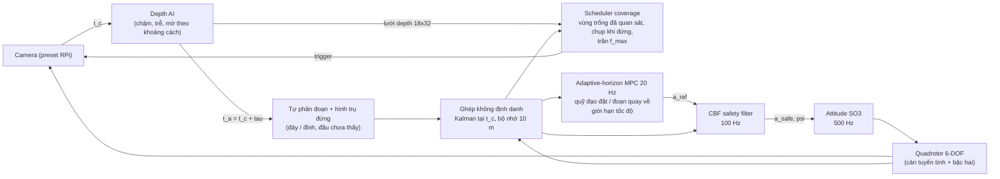

# DART-UAV

**DART — Delay-Aware, Risk-Triggered perception–control co-design** cho quadrotor giá rẻ tránh vật cản lớn bằng
một camera và mạng depth monocular chạy chậm, với chi phí tính toán thấp nhất có thể.
Mô phỏng hoàn toàn bằng **MATLAB/Simulink chạy trên cloud (GitHub Actions)**, không cần cài đặt hay chạy gì ở máy local.

| | |
|---|---|
| **Kết quả hiện tại** | [`docs/results/results.md`](docs/results/results.md): lưới chốt, 36 000 lượt (tóm tắt ở [Mục 5](#5-kết-quả-hiện-tại)) |
| Tài liệu và kết quả cũ | [`docs/archive/`](docs/archive/README.md): tài liệu phương pháp LaTeX (bản 3), kết quả các vòng trước. **Không áp dụng cho phiên bản hiện tại** |
| Mô hình Simulink | sinh từ mã bởi [`simulink/dart_build_model.m`](simulink/dart_build_model.m) → `dart_closed_loop.slx` |
| Chạy trên cloud | tab **Actions** của repo: `CI`, `Experiments`, `Sweep`, `Debug case`, `Docs` |

---

## 1. Phạm vi

* **UAV giá rẻ, compute ít**, bay bình thường ở độ cao thấp. Chỉ cần tránh **vật cản lớn, tĩnh**: cây có tán thấp,
  bụi cây, nhà / ki-ốt, xe / container, tảng đá. Không cần né cột mảnh.
* Ít vật cản thì bay nhanh, nhiều vật cản thì bay chậm. Giới hạn vật lý lấy từ mô hình động học quadrotor chuẩn.
* Suy luận ảnh là phần tốn tính toán nhất, nên mục tiêu là **ít lần suy luận nhất mà vẫn an toàn**.
* Thuật toán coi mọi vật là tĩnh. Vật di chuyển chỉ xuất hiện trong một phần thế giới kiểm thử khó, và thuật toán
  không được báo trước.
* Không giới hạn thời gian. Một lượt chỉ dừng khi về đích, va chạm, hoặc kẹt (không tiến thêm 1 m dọc quỹ đạo
  trong 60 s).

## 2. Phương pháp (phiên bản chốt, commit `2a536b1`)

1. **Camera và mạng depth mô phỏng theo phần cứng thật** ([`dart_camera_preset.m`](src/config/dart_camera_preset.m),
   [`dart_depth_network.m`](src/perception/dart_depth_network.m)). Có bốn preset camera Raspberry Pi; mặc định là
   Camera Module 3 Wide (102×67°), mạng depth chạy ở 320×180, suy luận 80 ms. Cảnh được render siêu lấy mẫu rồi lấy
   trung bình theo diện tích pixel. Ảnh càng xa càng mờ (blur theo khoảng cách), có thêm mờ chuyển động, sai số tỉ lệ
   và dịch chuyển theo từng khung, trường sai số tương quan, nhiễu pixel, ngoại lai và sương mù (tuỳ chọn).
   Tầm phát hiện đo được (≥ 90 % khung, vật bán kính 1 m) là 30 m, dùng R_eff = 26 m.
2. **Vật cản là hình trụ đứng** ([`dart_extract_obstacles.m`](src/perception/dart_extract_obstacles.m),
   [`dart_cyl_dist.m`](src/util/dart_cyl_dist.m)). UAV chỉ nhận ảnh depth của mạng, **tự phân đoạn** vật cản (vùng depth
   liên thông, lọc pixel bay và mép), rồi phủ mỗi vùng bằng một hoặc nhiều hình trụ đứng:
   * trục và bán kính ngang lấy từ cung nhìn thấy trong mặt phẳng ngang (phương thẳng đứng lấy từ tư thế lúc chụp, tức
     hướng trọng lực của IMU); vật rộng (tường, dãy nhà) được chia thành nhiều hình trụ;
   * đáy và đỉnh là điểm thấp nhất / cao nhất đo được. Nếu đáy (đỉnh) chạm mép ảnh hoặc bị một vật gần hơn che, đầu đó
     coi như **chưa thấy**: hình trụ kéo xuống đất (lên cao) cho tới khi nhìn thấy đầu đó.
   Nhờ vậy xe thấp và tán cây cao không còn chắn độ cao bay như khi dùng hình cầu bao trùm.
3. **Bộ nhớ vật cản** ([`dart_tracks_process_msg.m`](src/estimation/dart_tracks_process_msg.m)): ghép track không cần định
   danh, mỗi track là một **mốc tĩnh** cập nhật Kalman tại **đúng thời điểm chụp** (bù trễ). Bán kính, đáy, đỉnh được
   làm mượt qua các lần đo. Track ra khỏi trường nhìn được nhớ trong **10 m**.
4. **Khoảng cách tới hình trụ** dùng chung cho mọi khối: lớp an toàn phanh (CBF 100 Hz), các đại lượng rủi ro, bộ lập lịch
   và giới hạn tốc độ dùng "hình cầu tương đương cục bộ" tại vị trí UAV, cho đúng khoảng cách và pháp tuyến của hình trụ
   ([`dart_obstacles_local.m`](src/estimation/dart_obstacles_local.m)); MPC tuyến tính hoá hình trụ tại từng điểm dự đoán;
   đường vòng và phát hiện đường bị chặn tính trực tiếp trên hình trụ (vật thấp hơn độ cao bay có thể bay qua).
5. **Lập lịch perception "coverage"** (biến thể `E_COV`, phương pháp đề xuất,
   [`dart_scheduler.m`](src/scheduling/dart_scheduler.m)). Chỉ chụp khi đoạn quỹ đạo dự kiến phía trước, tới quãng
   cần để dừng sau kết quả kế tiếp, **chưa nằm trong vùng trống đã quan sát** (vùng trống "khắc tia": lưới depth thô
   18×32 gửi kèm mỗi kết quả; điểm sau bề mặt đo được không tính là đã thấy). Chụp thêm khi bất định của một vật gần quá
   lớn, khi đang trên hướng va chạm, và **chụp liên tục khi UAV gần như đứng yên** (|v| < 1 m/s), để các vật quanh nó được
   đo lại từ gần.
6. **Tần số quét tối đa `f_max` là trần cứng** cho mọi bộ lập lịch và mọi sự kiện (kể cả khẩn cấp): không bao giờ quá
   `f_max` khung/giây. Mặc định 3 Hz; lưới chốt quét 0.5–5 Hz. Hai bộ lập lịch so sánh: `FR_SAFE` (chụp đều đúng
   `f_max`) và `E_DART` (thích nghi theo rủi ro, cũng bị chặn bởi `f_max`).
7. **Giới hạn tốc độ** ([`dart_derive_limits.m`](src/config/dart_derive_limits.m)):
   * vật lý: T/W 2.4, dự trữ lực đẩy 40 % → nghiêng tối đa 46°, phanh 6.2 m/s², tốc độ giới hạn bởi cản 16.7 m/s,
     v_max = 15 m/s; với camera hẹp, v_max còn bị giới hạn để đường bay không rời khỏi ảnh khi UAV chúi mũi;
   * theo tầm nhìn: v·T_r + v²/(2a_b) + d_s ≤ R_eff, T_r = max(1/f_max, độ trễ) + độ trễ
     ([`dart_perception_speed.m`](src/scheduling/dart_perception_speed.m));
   * theo mật độ vật cản ([`dart_clutter_speed.m`](src/control/dart_clutter_speed.m), bật mặc định): tốc độ tiếp cận mỗi vật
     trong hành lang bay phải phanh kịp.
8. **MPC horizon thích nghi + quỹ đạo đặt / đoạn quay về**: UAV bám quỹ đạo đặt; khi phía trước bị chặn, tham chiếu là
   đường ngắn nhất không va chạm tới điểm sớm nhất sau đoạn bị chặn, trong lúc đó không phạt sai lệch.
9. **Siêu tham số κ ∈ [0, 1]** đánh đổi an toàn ↔ thời gian (0.5 mặc định).



Quy ước trong chú thích mã nguồn: "Eq. n" là số phương trình của bản đề xuất gốc. "method §n" là mục của tài liệu
phương pháp bản 3, nay nằm ở [`docs/archive/method/`](docs/archive/method/); tài liệu đó viết **trước** các thay đổi ở
mục 1, 2, 4, 5, 6, 7 phía trên. Mô tả của phiên bản chốt là mục này cùng chú thích trong mã.

## 3. Chạy trên cloud (GitHub Actions)

Mọi thứ chạy trên máy ảo của GitHub. Có năm workflow:

| Workflow | Kích hoạt | Làm gì | Kết quả |
|---|---|---|---|
| **CI** | tự động mỗi lần push | (a) *Octave*: toàn bộ unit test + 1 nhiệm vụ demo, **không cần license**; (b) *MATLAB + Simulink*: unit test, sinh model `.slx`, chạy vòng kín trong Simulink | Artifact `octave-results`, `matlab-simulink-results` + bảng ở trang tóm tắt của run |
| **Sweep** | thủ công | Quét một tham số (`speed`, `camera`, `camspeed`, `latency`, `rate`, `noise`, `shift`, `kappa`, `rmin`, `fog`) qua danh sách giá trị; mỗi (kịch bản, giá trị) một job song song | Artifact `sweep-…`; log có dòng `FAILINFO` / `WORLD` |
| **Experiments** | thủ công | Monte-Carlo: biến thể × kịch bản × seed, engine `matlab` / `simulink` / `octave` | Artifact `ablation-…` |
| **Debug case** | thủ công | Chạy lại một ca và in diễn biến những giây cuối | Log + artifact |
| **Docs** | khi `docs/**` thay đổi | Biên dịch tài liệu phương pháp (bản lưu trữ) bằng XeLaTeX | Artifact `DART-method-pdf` |

### 3.1. License MATLAB trên GitHub Actions

GitHub Actions cài MATLAB/Simulink qua [`matlab-actions/setup-matlab`](https://github.com/matlab-actions/setup-matlab).

* **Repo public** (như hiện tại): MathWorks cấp license tự động, không cần làm gì.
* **Repo private**: cần **batch licensing token**:
  1. Đăng ký token tại [MATLAB Batch Licensing Pilot](https://www.mathworks.com/support/batch-tokens.html) (cần tài khoản MathWorks có license MATLAB + Simulink, ví dụ license của trường).
  2. Vào *Settings → Secrets and variables → Actions → New repository secret*, tên **`MLM_LICENSE_TOKEN`**, dán token.
  3. Push bất kỳ — job *MATLAB + Simulink* sẽ chạy.

Khi chưa có license, job MATLAB của **CI** được **bỏ qua kèm cảnh báo**, còn job Octave vẫn chạy và kiểm tra toàn bộ
thuật toán. Các workflow Experiments / Sweep / Debug case không có bước kiểm tra này: thiếu license thì chúng thất bại.

### 3.2. Chạy lại lưới chốt

Mọi trường hợp dùng cùng thế giới, cùng tốc độ yêu cầu 6 / 10 / 15 m/s và cùng phương án. *Actions → Sweep → Run
workflow*, `engine = matlab`; mỗi dòng của cột `seeds` là một lần chạy (chạy song song):

| Phần | `param` | `values` | `scenarios` | `variants` | `seeds` |
|---|---|---|---|---|---|
| Quét tần số tối đa | `speedrate` | 30 giá trị: 100 × tốc độ + 10 × tần số, tốc độ 6 / 10 / 15, tần số 0.5…5 Hz (`[605, 610, …, 650, 1005, …, 1550]`) | `["SN"]`, `["SH"]`, `["SE"]` | `E_COV,FR_SAFE,E_DART` | SN `1:20`, `21:40`, `41:60`; SH `1:10`, `11:20`, `21:30`; SE `1:30` |
| Bỏ giới hạn tốc độ theo mật độ | `speedrate` | 30 giá trị như trên | từng kịch bản | `COV_NOCLUT` | SN `1:60`; SH `1:30`; SE `1:30` |
| So sánh camera | `camspeedrate` | 90 giá trị: 10000 × preset (1, 2, 4) + 100 × tốc độ + 10 × tần số | từng kịch bản | `E_COV,FR_SAFE` | SN `1:30`, `31:60`; SH `1:15`, `16:30`; SE `1:30` |

Mọi phần đều chạy trên cùng lưới tần số 0.5–5 Hz. `speedrate` 1025 = 10 m/s, trần 2.5 Hz; `camspeedrate` 41025 =
preset camera 4 (Module 3 Wide 640×360) ở 10 m/s, trần 2.5 Hz; camera mặc định (preset 3) lấy từ phần quét tần số. Mỗi lượt in một dòng kết quả (kèm `gap` = khoảng cách nhỏ nhất giữa hai
lần chụp) và một dòng `DENS` (thời gian, quãng bay, số khung theo số vật trong 15 m). Tải log (bước *Run sweep point*
của mỗi job) và lập bảng: `python3 docs/results/parse_results.py '<log>'` (một nhóm log) hoặc
`python3 docs/results/final_tables.py` (toàn bộ lưới chốt, các bảng của `results.md`).

## 4. Kịch bản và biến thể

| Kịch bản | Mô tả |
|---|---|
| **SN** (bay thường) | tuyến 300 m (1–3 đoạn, độ cao 2–3.5 m) cắt thành các vùng 40–80 m: 35 % trống, 40 % thưa (1–3 vật, một nửa sát đường bay), 25 % dày (6–12 vật). Vật cản lớn: cây tán thấp, bụi cây, nhà, xe / container, đá; khe hở ≥ 3.5 m |
| **SH** (khó, thử ít) | như SN nhưng mọi vùng đều dày; sương mù (tầm nhìn 200 m) ở seed lẻ; 2 xe cắt ngang ở seed chia hết cho 3 |
| **SE** (siêu dễ, đời thường) | tuyến thẳng 200 m; seed chọn cảnh theo vòng 6: bãi trống, một cây giữa đường, đại lộ hai hàng cây, xe đỗ ven đường + một xe tải chắn đường, dãy nhà ven đường, khe phố giữa hai dãy nhà ([`dart_scenario_easy.m`](src/config/dart_scenario_easy.m)) |
| S1–S3, SR | kịch bản của các phiên bản cũ (còn trong mã, kết quả ở `docs/archive/`) |

| Biến thể | Lập lịch perception | Ghi chú |
|---|---|---|
| **E_COV** | coverage, trần `f_max` | phương pháp đề xuất |
| FR_SAFE | chụp đều đúng `f_max` | cùng mọi lớp an toàn |
| E_DART | thích nghi theo rủi ro, trần `f_max` | khoảng quét tính từ khoảng mở an toàn |
| COV_NOCLUT | coverage, trần `f_max` | E_COV **tắt giới hạn tốc độ theo mật độ** (thử xem khối đó có cần không) |

**Giới hạn tốc độ theo mật độ** (`dart_clutter_speed.m`): với mọi vật trong hành lang bay phía trước, tốc độ mong
muốn bị hạ sao cho tốc độ lao về phía vật luôn phanh kịp, v cos θ ≤ 0.9 √(2 a_b (d − d_s)) (d: khoảng cách đã trừ độ
bất định, θ: góc giữa hướng bay và hướng tới vật), không dưới 1.5 m/s: nhiều vật phía trước thì đi chậm từ sớm, đường
trống thì không bị giới hạn. Tắt nó (COV_NOCLUT), UAV vẫn có giới hạn vật lý, giới hạn theo tầm nhìn, lớp an toàn phanh
100 Hz (cùng điều kiện phanh nhưng chỉ sửa lệnh gia tốc ở phút chót) và chế độ khẩn cấp.

Các biến thể cũ (`A_FR_FN` … `G_FR_LOW`, `Z_ZHUYI`, `O_ORACLE`, `R_*`, `K<k>`, `MEM<d>`, `FR_SAFE_<f>`, `FN_SAFE_n`,
`COVB<f>`, `E_NOCAP`, `FRNC<f>`, `COV_EV`, `COV_NOCAP`) vẫn có trong
[`dart_apply_variant.m`](src/config/dart_apply_variant.m); biến thể nào định nghĩa tần số cố định thì đặt `f_max` bằng
tần số đó.

## 5. Kết quả hiện tại

Chi tiết: [`docs/results/results.md`](docs/results/results.md). 36 000 lượt (thuật toán commit `2a536b1`), mọi phần
trên cùng lưới trần tần số 0.5–5 Hz, cùng thế giới và tốc độ yêu cầu 6 / 10 / 15 m/s; camera mặc định Module 3 Wide.

| | SN bay thường | SH khó | SE siêu dễ |
|---|---|---|---|
| E_COV, trần 3 Hz: va chạm tĩnh / kẹt / suy luận mỗi nhiệm vụ (trung vị) | 3 / 0 / 77 (của 180) | 9 / 0 / 134 (của 90) | 0 / 0 / 42 (của 90) |
| FR_SAFE, 3 Hz đều | 4 / 0 / 134 | 1 / 0 / 192 | 1 / 0 / 96 |
| va chạm tĩnh, gộp trần 1.5–5 Hz: E_COV / FR_SAFE / E_DART / COV_NOCLUT | 2.4 / 2.0 / 3.9 / 2.2 % | 8.2 / 5.8 / 12.2 / 7.5 % | 0.3 / 0.4 / 1.1 / 0.4 % |
| suy luận của E_COV so với FR_SAFE cùng trần (1.5–5 Hz) | 0.54–0.72 | 0.61–0.81 | 0.50–0.63 |

* Trần `f_max` được giữ đúng ở cả 36 000 lượt; kẹt gần như hết (≤ 0.4 % ở trần ≥ 1.5 Hz, trừ COV_NOCLUT trên SH 1.2 %).
* Trần cần ≥ 1.5 Hz (0.5 Hz: 22–31 % lượt SN va chạm); từ khoảng 2 Hz trở lên, tăng trần không giảm va chạm thêm rõ rệt.
* E_COV an toàn như FR_SAFE trên SN, SE (p ≥ 0.5) với ít hơn 28–50 % suy luận; trên SH kém hơn một chút
  (8.2 so với 5.8 %, p = 0.098). Tốt hơn E_DART trên SN và SH (p = 0.033, 0.015). Giới hạn tốc độ theo mật độ
  không thấy tác dụng an toàn đo được.
* Tốc độ tự giảm theo mật độ (SN, yêu cầu 15 m/s: 11.2 m/s khi trống, 3.8 m/s khi ≥ 6 vật trong 15 m) và E_COV chụp
  dày hơn ở chỗ đông vật (1.76 → 2.59 khung/s).
* Camera góc rộng là điều kiện cần: camera hẹp (v2, Module 3) va chạm 11–12 % trên SN.
* Va chạm còn lại (Mục 8) gần như đều cùng một kiểu: UAV đang vòng tránh, chạm một vật đã có trong bộ nhớ, phần lớn
  khi vật đã ra khỏi khung hình.

Kết quả của phiên bản trước (hình cầu, chưa chụp khi đứng yên) ở
[`docs/archive/results/round7.md`](docs/archive/results/round7.md) và **không áp dụng** cho phiên bản chốt; so sánh
hai phiên bản ở `results.md`, Mục 6.

## 6. Cấu trúc mã nguồn

```
dart_setup.m                  thêm đường dẫn
src/config/                   tham số mặc định, giới hạn vật lý, preset camera, kịch bản (SN/SH/SE; S1–S3, SR cũ), biến thể, quét, κ
src/world/                    hình dạng vật cản (cầu, hộp, trụ), khoảng cách có dấu, clearance thật
src/plant/                    quadrotor 6-DOF (cản tuyến tính + bậc hai), bộ điều khiển attitude SO(3)
src/perception/               render siêu lấy mẫu, mạng depth tổng hợp, tự phân đoạn, hình trụ đứng, lưới depth, message
src/estimation/               bộ đệm pose, ghép không định danh, Kalman tại thời điểm chụp, bộ nhớ track, hình cầu tương đương cục bộ
src/planning/                 quỹ đạo đặt, đoạn bị chặn, chế độ BÁM / QUAY VỀ, đường vòng ngắn nhất
src/scheduling/               coverage (vùng trống đã quan sát), thích nghi, cố định; tầm và tốc độ theo perception
src/control/                  horizon thích nghi, MPC (QP), CBF, giới hạn tốc độ theo mật độ, yaw, bước điều khiển
src/util/                     QP interior-point (thuần MATLAB), khoảng cách tới hình trụ, tiện ích hình học, RNG
sim/dart_sim.m                MATLAB engine (cùng hàm, cùng đa tần số với Simulink)
simulink/                     System objects + script sinh model + runner Simulink
experiments/                  chạy 1 ca, ablation, metric, phân loại thất bại, tầm phát hiện, tốc độ theo mật độ, hình
tests/                        unit test (chạy được trên MATLAB và Octave)
ci/                           điểm vào của các workflow
docs/results/                 kết quả hiện tại, log gốc (raw/), script lập bảng
docs/archive/                 tài liệu phương pháp bản 3 và kết quả các phiên bản cũ (lưu trữ)
docs/figures/                 script vẽ cảnh (plot_scene.py) và vẽ một lượt bay chi tiết (plot_stuck.py)
docs/literature/              danh sách đọc, ghi chú đọc toàn văn, định vị tính mới
```

Model Simulink `dart_closed_loop.slx`:

| Khối | Loại | Tần số |
|---|---|---|
| Quadrotor 6DOF + Integrator | MATLAB Function (codegen) | liên tục, ode4 2 ms |
| Attitude Controller | MATLAB Function (codegen) | 2 ms |
| DART Controller (tracker, scheduler, MPC, CBF) | MATLAB System `DartControllerSys` (interpreted) | 10 ms (MPC 50 ms bên trong) |
| Camera + Depth AI | MATLAB System `DartPerceptionSys` (không direct feed-through) | 10 ms, theo sự kiện |
| Ground Truth Monitor → Stop (đích, va chạm, kẹt) | MATLAB System `DartMonitorSys` | 10 ms |

Model được sinh lại từ mã ở mỗi lần CI nên luôn khớp với mã nguồn; *đừng sửa tay file `.slx`*, hãy sửa `dart_build_model.m`.

## 7. Tuỳ biến

* Tham số: [`src/config/dart_default_config.m`](src/config/dart_default_config.m) (mọi tham số có chú thích, đơn vị SI).
* Camera: `cfg = dart_camera_preset(cfg, k)` (1 v2, 2 Module 3, 3 Module 3 Wide, 4 Module 3 Wide 640×360); hàm này
  tính lại giới hạn vật lý và tầm nhìn. Thêm camera mới: thêm `case` trong [`dart_camera_preset.m`](src/config/dart_camera_preset.m)
  kèm bảng tầm phát hiện đo bằng [`experiments/dart_eval_detection_range.m`](experiments/dart_eval_detection_range.m).
* Kịch bản mới: thêm `case` trong [`src/config/dart_scenario.m`](src/config/dart_scenario.m).
* Biến thể mới: thêm `case` trong [`src/config/dart_apply_variant.m`](src/config/dart_apply_variant.m).
* Đánh đổi an toàn ↔ thời gian: `cfg.tradeoff.kappa` (0…1) hoặc biến thể `K<k>`.
* Tần số quét tối đa: `cfg.sched.f_max` (trần cứng cho mọi bộ lập lịch); ngưỡng "đứng yên" `cfg.sched.v_stall`.
* Vẽ chi tiết một lượt (vật UAV đang nhớ, đường vòng, các lần chụp): workflow *Debug case* với ô `cases`
  (ví dụ `SN:10:12;SH:6:5`), rồi `python3 docs/figures/plot_stuck.py <thư mục json> <thư mục hình>`.

```matlab
dart_setup;
res = dart_run_case('E_COV', 'SN', 1, 'matlab', @(c) dart_apply_sweep(c, 'speed', 10));   % hoặc 'simulink'
m = dart_metrics(res); dart_plot_run(res, 'run.png');
dart_eval_speed_density('E_COV', 'SE', 3, 'speedrate', 1530);   % 15 m/s, trần 3 Hz: tốc độ, tần số chụp theo mật độ
```

## 8. Giới hạn hiện tại

* **Kiểu thất bại chính: va chạm với vật tĩnh lúc vòng tránh.** Ở trần ≥ 1.5 Hz với camera mặc định, mọi va chạm tĩnh
  xảy ra khi UAV đang vòng tránh và với một vật đã có trong bộ nhớ; 79 % khi vật đã ra khỏi khung hình. Tỉ lệ khoảng
  2 % trên SN, 6–8 % trên SH, cao hơn nhiều với camera hẹp. Giả thuyết (chưa kiểm chứng từng ca): hình trụ dựng từ
  phần nhìn thấy không phủ mặt bên / mặt sau của khối hộp và phần tán cây chìa ra, và không được sửa khi vật đã ra
  khỏi khung hình. Chưa sửa trong bản chốt.
* **Chỉ vật tĩnh.** Vật di chuyển chỉ được thấy lại sau mỗi khung, không dự đoán chuyển động; va chạm với xe cắt
  ngang ở SH được tách riêng và không tính vào kết quả chính (ngoài phạm vi).
* Chỉ mô phỏng. Mạng depth được thay bằng mô hình sai số tổng hợp trên ảnh depth ray-casting (không render RGB, không
  có mặt đất). Thông số camera lấy từ trang của các nhà bán lẻ.
* Vật cản bất kỳ được phủ bằng hình trụ đứng: vẫn bảo thủ với vật dài theo phương ngang (xe, container nhìn chéo) và
  với tán cây rộng hơn thân. Phương thẳng đứng lấy từ tư thế thật lúc chụp (thay cho hướng trọng lực của IMU, sai số
  roll/pitch bỏ qua).
* Bảng tầm phát hiện của camera (R_eff) được đo trước khi đổi sang hình trụ (cùng bước phân đoạn), chưa đo lại.
* Kết quả MATLAB trên các máy chạy GitHub khác nhau có thể lệch nhẹ ở cùng mã; kết luận được phát biểu ở dạng thống kê.
* Bộ thử nghiệm chạy bằng MATLAB engine; phần Simulink chỉ được kiểm tra bằng nhiệm vụ demo của CI.
