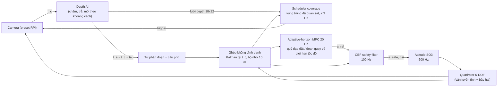

# DART-UAV

**DART — Delay-Aware, Risk-Triggered perception–control co-design** cho quadrotor giá rẻ tránh vật cản lớn bằng
một camera và mạng depth monocular chạy chậm, với chi phí tính toán thấp nhất có thể.
Mô phỏng hoàn toàn bằng **MATLAB/Simulink chạy trên cloud (GitHub Actions)**, không cần cài đặt hay chạy gì ở máy local.

| | |
|---|---|
| **Kết quả hiện tại** | [`docs/results/round6.md`](docs/results/round6.md) (tóm tắt ở [Mục 5](#5-kết-quả-hiện-tại)) |
| Tài liệu và kết quả cũ | [`docs/archive/`](docs/archive/README.md): tài liệu phương pháp LaTeX (bản 3), kết quả các vòng trước. **Không áp dụng cho phiên bản hiện tại** |
| Mô hình Simulink | sinh từ mã bởi [`simulink/dart_build_model.m`](simulink/dart_build_model.m) → `dart_closed_loop.slx` |
| Chạy trên cloud | tab **Actions** của repo: `CI`, `Experiments`, `Sweep`, `Debug case`, `Docs` |

---

## 1. Phạm vi

* **UAV giá rẻ, compute ít**, bay bình thường ở độ cao thấp. Chỉ cần tránh **vật cản lớn, tĩnh**: cây có tán thấp,
  bụi cây, nhà / ki-ốt, xe / container, tảng đá. Không cần né cột mảnh.
* Ít vật cản thì bay nhanh, nhiều vật cản thì bay chậm. Giới hạn vật lý lấy từ mô hình động học quadrotor chuẩn.
* Suy luận ảnh là phần tốn tính toán nhất, nên mục tiêu là **ít lần suy luận nhất mà vẫn an toàn**.
* Thuật toán coi mọi vật là tĩnh. Vật di chuyển chỉ xuất hiện trong một phần thế giới kiểm thử khó, và thuật toán
  không được báo trước.
* Không giới hạn thời gian. Một lượt chỉ dừng khi về đích, va chạm, hoặc kẹt (không tiến thêm 1 m dọc quỹ đạo
  trong 60 s).

## 2. Phương pháp (phiên bản hiện tại)

1. **Camera và mạng depth mô phỏng theo phần cứng thật** ([`dart_camera_preset.m`](src/config/dart_camera_preset.m),
   [`dart_depth_network.m`](src/perception/dart_depth_network.m)). Có bốn preset camera Raspberry Pi; mặc định là
   Camera Module 3 Wide (102×67°), mạng depth chạy ở 320×180, suy luận 80 ms. Cảnh được render siêu lấy mẫu rồi lấy
   trung bình theo diện tích pixel. Ảnh càng xa càng mờ (blur theo khoảng cách), có thêm mờ chuyển động, sai số tỉ lệ
   và dịch chuyển theo từng khung, trường sai số tương quan, nhiễu pixel, ngoại lai và sương mù (tuỳ chọn).
   Tầm phát hiện đo được (≥ 90 % khung, vật bán kính 1 m) là 30 m, dùng R_eff = 26 m.
2. **Không có "đáp án"**: UAV chỉ nhận ảnh depth của mạng. Nó **tự phân đoạn** vật cản (vùng depth liên thông, lọc
   pixel bay và mép), phủ mỗi vùng bằng một hoặc nhiều hình cầu, rồi **ghép track không cần định danh**.
   Track là **mốc tĩnh**. Track ra khỏi trường nhìn được giữ làm **bộ nhớ trong 10 m**.
3. **Bù trễ**: mỗi ảnh gắn thời điểm chụp `t_c`; phép đo được chuyển sang khung quán tính bằng pose tại `t_c` và cập
   nhật Kalman tại `t_c`.
4. **Lập lịch perception "coverage"** (biến thể `E_COV`, phương pháp đề xuất,
   [`dart_scheduler.m`](src/scheduling/dart_scheduler.m)). Chỉ chụp khi đoạn quỹ đạo dự kiến phía trước, tới quãng
   cần để dừng sau kết quả kế tiếp, **chưa nằm trong vùng trống đã quan sát**. Vùng trống được tính kiểu "khắc tia":
   mỗi kết quả gửi kèm lưới depth thô 18×32, và một điểm chỉ được coi là trống nếu nằm trước bề mặt đầu tiên camera đo
   được qua ô đó ([`dart_depth_grid.m`](src/perception/dart_depth_grid.m),
   [`dart_scheduler_observed.m`](src/scheduling/dart_scheduler_observed.m)). Vùng bị vật cản che không được tính là
   đã thấy. Bộ lập lịch còn kích hoạt khi bất định của một vật gần quá lớn, hoặc khi đang trên hướng va chạm.
   Tối đa `f_budget` = 3 khung/giây (ngân sách tính toán).
   Hai chế độ khác để so sánh: `adaptive` (`E_DART`, khoảng quét theo rủi ro) và `fixed` (`FR_SAFE_f`, f Hz).
5. **Giới hạn tốc độ** ([`dart_derive_limits.m`](src/config/dart_derive_limits.m)):
   * vật lý: T/W 2.4, dự trữ lực đẩy 40 % → nghiêng tối đa 46°, phanh 6.2 m/s², tốc độ giới hạn bởi cản 16.7 m/s,
     v_max = 15 m/s; với camera hẹp, v_max còn bị giới hạn để đường bay không rời khỏi ảnh khi UAV chúi mũi;
   * theo tầm nhìn: v·T_r + v²/(2a_b) + d_s ≤ R_eff, với T_r là chu kỳ ngân sách cộng độ trễ
     ([`dart_perception_speed.m`](src/scheduling/dart_perception_speed.m));
   * theo mật độ vật cản: [`dart_clutter_speed.m`](src/control/dart_clutter_speed.m), bật mặc định. Khi bay thường
     nó không cho cải thiện đo được; ở kịch bản dày đặc nó có xu hướng giúp (xem Mục 5).
6. **MPC horizon thích nghi + quỹ đạo đặt / đoạn quay về**: UAV bám quỹ đạo đặt. Khi phía trước bị chặn, tham chiếu
   là đường ngắn nhất không va chạm tới điểm sớm nhất sau đoạn bị chặn, và trong lúc đó không phạt sai lệch.
7. **Lớp an toàn braking-CBF** ở 100 Hz, có độ phồng theo bất định.
8. **Siêu tham số κ ∈ [0, 1]** đánh đổi an toàn ↔ thời gian (0.5 mặc định).



Quy ước trong chú thích mã nguồn: "Eq. n" là số phương trình của bản đề xuất gốc. "method §n" là mục của tài liệu
phương pháp bản 3, nay nằm ở [`docs/archive/method/`](docs/archive/method/); tài liệu đó viết **trước** các thay đổi ở
mục 1, 4, 5 phía trên.

## 3. Chạy trên cloud (GitHub Actions)

Mọi thứ chạy trên máy ảo của GitHub. Có năm workflow:

| Workflow | Kích hoạt | Làm gì | Kết quả |
|---|---|---|---|
| **CI** | tự động mỗi lần push | (a) *Octave*: toàn bộ unit test + 1 nhiệm vụ demo, **không cần license**; (b) *MATLAB + Simulink*: unit test, sinh model `.slx`, chạy vòng kín trong Simulink | Artifact `octave-results`, `matlab-simulink-results` + bảng ở trang tóm tắt của run |
| **Sweep** | thủ công | Quét một tham số (`speed`, `camera`, `camspeed`, `latency`, `rate`, `noise`, `shift`, `kappa`, `rmin`, `fog`) qua danh sách giá trị; mỗi (kịch bản, giá trị) một job song song | Artifact `sweep-…`; log có dòng `FAILINFO` / `WORLD` |
| **Experiments** | thủ công | Monte-Carlo: biến thể × kịch bản × seed, engine `matlab` / `simulink` / `octave` | Artifact `ablation-…` |
| **Debug case** | thủ công | Chạy lại một ca và in diễn biến những giây cuối | Log + artifact |
| **Docs** | khi `docs/**` thay đổi | Biên dịch tài liệu phương pháp (bản lưu trữ) bằng XeLaTeX | Artifact `DART-method-pdf` |

### 3.1. License MATLAB trên GitHub Actions

GitHub Actions cài MATLAB/Simulink qua [`matlab-actions/setup-matlab`](https://github.com/matlab-actions/setup-matlab).

* **Repo public** (như hiện tại): MathWorks cấp license tự động, không cần làm gì.
* **Repo private**: cần **batch licensing token**:
  1. Đăng ký token tại [MATLAB Batch Licensing Pilot](https://www.mathworks.com/support/batch-tokens.html) (cần tài khoản MathWorks có license MATLAB + Simulink, ví dụ license của trường).
  2. Vào *Settings → Secrets and variables → Actions → New repository secret*, tên **`MLM_LICENSE_TOKEN`**, dán token.
  3. Push bất kỳ — job *MATLAB + Simulink* sẽ chạy.

Khi chưa có license, job MATLAB của **CI** được **bỏ qua kèm cảnh báo**, còn job Octave vẫn chạy và kiểm tra toàn bộ
thuật toán. Các workflow Experiments / Sweep / Debug case không có bước kiểm tra này: thiếu license thì chúng thất bại.

### 3.2. Chạy lại bộ thử nghiệm hiện tại

*Actions → Sweep → Run workflow* (chia seed thành nhiều lần chạy để song song):

| Thử nghiệm | `param` | `values` | `scenarios` | `variants` | `seeds` |
|---|---|---|---|---|---|
| Bay thường | `speed` | `[6, 10, 15]` | `["SN"]` | `E_COV,COVB1,COV_NOCLUT,FR_SAFE_3,FR_SAFE_1,E_DART` | `1:10`, `11:20`, `21:30` |
| So sánh camera | `camspeed` | `[110, 115, 210, 215, 310, 315, 410, 415]` | `["SN"]` | `E_COV,FR_SAFE_3` | `1:15` |
| Kịch bản khó | `speed` | `[10]` | `["SH"]` | `E_COV,FR_SAFE_3,E_DART` | `1:15` |

`camspeed` = 100 × preset camera + tốc độ yêu cầu (310 = Camera Module 3 Wide ở 10 m/s). Tải log và lập bảng:
`python3 docs/results/parse_results.py '<log>'`.

## 4. Kịch bản và biến thể

| Kịch bản | Mô tả |
|---|---|
| **SN** (bay thường) | tuyến 300 m (1–3 đoạn, độ cao 2–3.5 m) cắt thành các vùng 40–80 m: 35 % trống, 40 % thưa (1–3 vật, một nửa sát đường bay), 25 % dày (6–12 vật). Vật cản lớn: cây tán thấp, bụi cây, nhà, xe / container, đá; khe hở ≥ 3.5 m |
| **SH** (khó, thử ít) | như SN nhưng mọi vùng đều dày; sương mù (tầm nhìn 200 m) ở seed lẻ; 2 xe cắt ngang ở seed chia hết cho 3 |
| S1–S3, SR | kịch bản của các phiên bản cũ (còn trong mã, kết quả ở `docs/archive/`) |

| Biến thể | Lập lịch perception | Ghi chú |
|---|---|---|
| **E_COV** | coverage, ngân sách 3 Hz | phương pháp đề xuất |
| COVB<f> | coverage, ngân sách f Hz | ví dụ `COVB1` |
| COV_NOCLUT | coverage, 3 Hz | không có giới hạn tốc độ theo mật độ |
| FR_SAFE_f | cố định f Hz | cùng mọi lớp an toàn |
| E_DART | thích nghi theo rủi ro | khoảng quét tính từ khoảng mở an toàn |

Các biến thể cũ (`A_FR_FN` … `G_FR_LOW`, `Z_ZHUYI`, `O_ORACLE`, `R_*`, `K<k>`, `MEM<d>`, `FN_SAFE_n`, `E_NOCAP`,
`FRNC<f>`, `COV_EV`, `COV_NOCAP`) vẫn có trong [`dart_apply_variant.m`](src/config/dart_apply_variant.m).

## 5. Kết quả hiện tại

Chi tiết, bảng đầy đủ và log gốc: [`docs/results/round6.md`](docs/results/round6.md). MATLAB engine, commit `4a1fcfa`;
camera Module 3 Wide trừ phần so sánh camera.

**Bay thường SN** (30 thế giới × 3 tốc độ yêu cầu 6 / 10 / 15 m/s, 90 lượt mỗi biến thể):

| Biến thể | Va chạm | Kẹt | Suy luận mỗi nhiệm vụ (trung vị, 6 / 10 / 15 m/s) | Khung / s |
|---|---|---|---|---|
| **E_COV** | 1 | 5 | 93 / 75 / 71 | 1.4–1.8 |
| FR_SAFE_3 | 0 | 1 | 182 / 127 / 112 | 2.95 |
| E_DART | 1 | 0 | 126 / 140 / 175 | 2.2–4.5 |
| COVB1 (1 Hz) | 4 | 6 | 46 / 37 / 34 | 0.6–0.75 |
| FR_SAFE_1 | 3 | 5 | 69 / 48 / 46 | 1.0 |

**Kịch bản khó SH** (15 thế giới, 10 m/s): E_COV 14/15 tới đích, 0 va chạm, 158 suy luận; FR_SAFE_3 15/15, 240;
E_DART 14/15 (1 va chạm), 328.

Kết luận:

1. **E_COV an toàn như tần số cố định 3 Hz** nhưng ít hơn **37–49 %** số lần suy luận. Nơi trống nó chụp khoảng
   0.5–1.4 khung/s, gần vật cản khoảng 1–2.6 khung/s.
2. **1 Hz là quá ít** ở các tốc độ này (có va chạm ở 15 m/s).
3. **Tốc độ tự thích ứng với mật độ**: khoảng 9–10 m/s khi không có vật nào trong 15 m, khoảng 7 m/s khi có 3–5 vật.
   Giới hạn tốc độ riêng theo mật độ **chỉ có ích ở nơi dày đặc**: khi bay thường (180 lượt mỗi bản, thế giới 1–60)
   không có giới hạn cho 0 va chạm / 3 kẹt, có giới hạn cho 1 va chạm / 8 kẹt; ở kịch bản khó (30 lượt mỗi bản,
   10 và 15 m/s) có giới hạn thất bại 3/30 (2 va chạm), không có giới hạn 8/30 (5 va chạm), p = 0.18. Vì vậy giữ bật.
4. **Camera** (15 thế giới × 2 tốc độ × 2 biến thể cho mỗi camera):

   | Camera | FOV | v_max | Va chạm / 60 lượt |
   |---|---|---|---|
   | Camera Module v2 | 62×49° | 13.1 m/s | 9 |
   | Camera Module 3 | 66×41° | 10.7 m/s | 11 |
   | **Camera Module 3 Wide, 320×180** | 102×67° | 15 m/s | 1 |
   | Camera Module 3 Wide, 640×360 (suy luận ×4) | 102×67° | 15 m/s | 1 |

   **Góc rộng mới là yếu tố quyết định** (2/120 so với 20/120, p = 6·10⁻⁵): camera hẹp mất dấu vật đang vòng tránh.
   Ảnh nét hơn và nhìn xa hơn không tự làm an toàn hơn. Khuyến nghị: Camera Module 3 Wide, mạng ở 320×180.

## 6. Cấu trúc mã nguồn

```
dart_setup.m                  thêm đường dẫn
src/config/                   tham số mặc định, giới hạn vật lý, preset camera, kịch bản (SN/SH; S1–S3, SR cũ), biến thể, quét, κ
src/world/                    hình dạng vật cản (cầu, hộp, trụ), khoảng cách có dấu, clearance thật
src/plant/                    quadrotor 6-DOF (cản tuyến tính + bậc hai), bộ điều khiển attitude SO(3)
src/perception/               render siêu lấy mẫu, mạng depth tổng hợp, tự phân đoạn, cầu phủ, lưới depth, message
src/estimation/               bộ đệm pose, ghép không định danh, Kalman tại thời điểm chụp, bộ nhớ track
src/planning/                 quỹ đạo đặt, đoạn bị chặn, chế độ BÁM / QUAY VỀ, đường vòng ngắn nhất
src/scheduling/               coverage (vùng trống đã quan sát), thích nghi, cố định; tầm và tốc độ theo perception
src/control/                  horizon thích nghi, MPC (QP), CBF, giới hạn tốc độ theo mật độ, yaw, bước điều khiển
src/util/                     QP interior-point (thuần MATLAB), tiện ích hình học, RNG
sim/dart_sim.m                MATLAB engine (cùng hàm, cùng đa tần số với Simulink)
simulink/                     System objects + script sinh model + runner Simulink
experiments/                  chạy 1 ca, ablation, metric, phân loại thất bại, tầm phát hiện, tốc độ theo mật độ, hình
tests/                        unit test (chạy được trên MATLAB và Octave)
ci/                           điểm vào của các workflow
docs/results/                 kết quả hiện tại, log gốc (raw/), script lập bảng
docs/archive/                 tài liệu phương pháp bản 3 và kết quả các phiên bản cũ (lưu trữ)
docs/figures/                 script vẽ cảnh (plot_scene.py)
docs/literature/              danh sách đọc, ghi chú đọc toàn văn, định vị tính mới
```

Model Simulink `dart_closed_loop.slx`:

| Khối | Loại | Tần số |
|---|---|---|
| Quadrotor 6DOF + Integrator | MATLAB Function (codegen) | liên tục, ode4 2 ms |
| Attitude Controller | MATLAB Function (codegen) | 2 ms |
| DART Controller (tracker, scheduler, MPC, CBF) | MATLAB System `DartControllerSys` (interpreted) | 10 ms (MPC 50 ms bên trong) |
| Camera + Depth AI | MATLAB System `DartPerceptionSys` (không direct feed-through) | 10 ms, theo sự kiện |
| Ground Truth Monitor → Stop (đích, va chạm, kẹt) | MATLAB System `DartMonitorSys` | 10 ms |

Model được sinh lại từ mã ở mỗi lần CI nên luôn khớp với mã nguồn; *đừng sửa tay file `.slx`*, hãy sửa `dart_build_model.m`.

## 7. Tuỳ biến

* Tham số: [`src/config/dart_default_config.m`](src/config/dart_default_config.m) (mọi tham số có chú thích, đơn vị SI).
* Camera: `cfg = dart_camera_preset(cfg, k)` (1 v2, 2 Module 3, 3 Module 3 Wide, 4 Module 3 Wide 640×360); hàm này
  tính lại giới hạn vật lý và tầm nhìn. Thêm camera mới: thêm `case` trong [`dart_camera_preset.m`](src/config/dart_camera_preset.m)
  kèm bảng tầm phát hiện đo bằng [`experiments/dart_eval_detection_range.m`](experiments/dart_eval_detection_range.m).
* Kịch bản mới: thêm `case` trong [`src/config/dart_scenario.m`](src/config/dart_scenario.m).
* Biến thể mới: thêm `case` trong [`src/config/dart_apply_variant.m`](src/config/dart_apply_variant.m).
* Đánh đổi an toàn ↔ thời gian: `cfg.tradeoff.kappa` (0…1) hoặc biến thể `K<k>`.

```matlab
dart_setup;
res = dart_run_case('E_COV', 'SN', 1, 'matlab', @(c) dart_apply_sweep(c, 'speed', 10));   % hoặc 'simulink'
m = dart_metrics(res); dart_plot_run(res, 'run.png');
dart_eval_speed_density('E_COV', 'SN', 1, 'speed', 15);   % tốc độ và tần số chụp theo mật độ vật cản
```

## 8. Giới hạn hiện tại

* Chỉ mô phỏng. Mạng depth được thay bằng mô hình sai số tổng hợp trên ảnh depth ray-casting (không render RGB, không
  có mặt đất). Thông số camera lấy từ trang của các nhà bán lẻ.
* Vật cản bất kỳ được phủ bằng hình cầu: bảo thủ với vật dẹt / dài. Chỉ vật tĩnh: vật di chuyển chỉ được thấy lại, không
  dự đoán chuyển động.
* Khoảng 3–5 % lượt bị **kẹt** (đứng gần như yên cạnh một vật đã nhớ, không va chạm): cực tiểu cục bộ của planner, rải
  rác ở các thế giới khác nhau. Đây là lỗi cục bộ, chưa tối ưu.
* Ở kịch bản khó, E_COV ở 15 m/s có 2/15 va chạm (vật đã nhớ, ngoài trường nhìn, lúc đang vòng tránh); kịch bản này
  chỉ thử ít (15 thế giới).
* Kết quả MATLAB trên các máy chạy GitHub khác nhau có thể lệch nhẹ: một job của vòng 6 cho thời gian khác vòng 5 ở
  cùng mã. Kết luận được phát biểu ở dạng thống kê.
* Bộ thử nghiệm hiện tại chạy bằng MATLAB engine; phần Simulink chỉ được kiểm tra bằng nhiệm vụ demo của CI.
